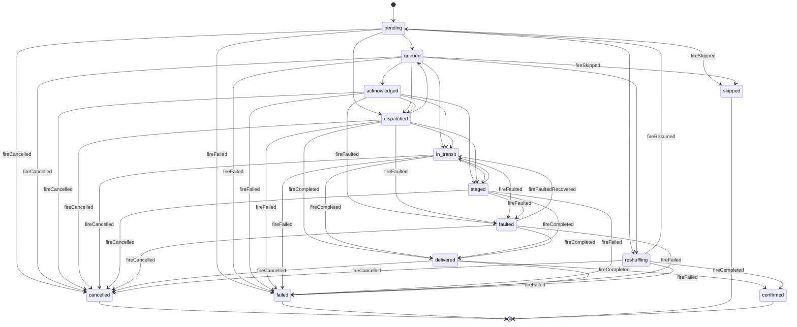
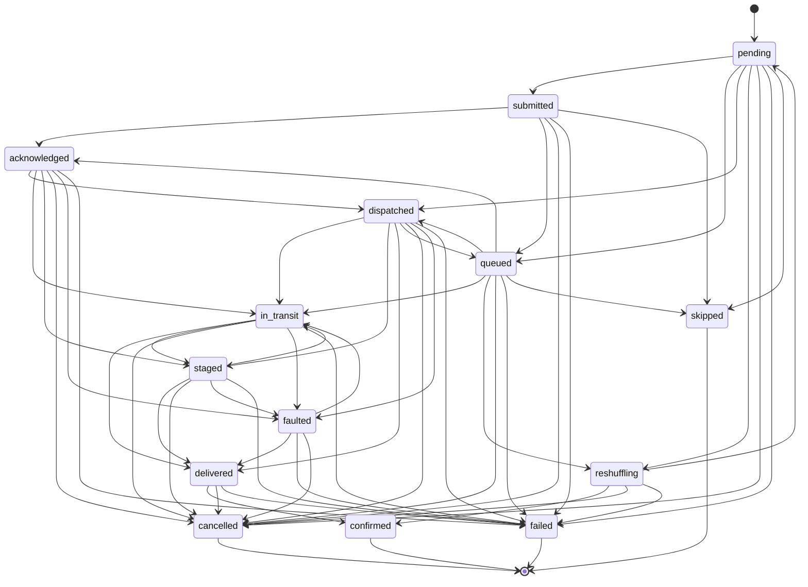

# Order Status Lifecycle

Verified against: b9210bce

**What this is:** the order lifecycle status vocabulary as it exists in the code
today — every status × who writes it × who reads it × what the operator sees.
Grounded in `protocol/status.go` (the enum), `protocol/types.go`
(`validTransitions` — the canonical state machine), the Core lifecycle
(`shingo-core/dispatch/lifecycle.go`), the Edge lifecycle
(`shingo-edge/orders/lifecycle_service.go`, `manager.go`), and the operator
HMI (`shingo-edge/www/static/operator-station/`). The code wins over this doc;
if they disagree, fix the doc.

---

## Two machines, one enum

The order-status enum is a superposition of **two state machines** that share
one string:

- **Core's planning machine** — the truth of *what Core is doing with the
  order*: is it hunting bins, queued behind a capacity gate, handed to the
  fleet, or done? Core's statuses are **planning truth**.
- **Edge's submission machine** — the truth of *what the operator at the line
  sees*: the order envelope was created and submitted, Core acknowledged it,
  a robot is moving, a bin has arrived. Edge's statuses are **submission /
  display truth**.

Most statuses mean the same thing on both sides (a `delivered` order has a bin
at the destination, period). Two are Edge-lifecycle words in practice:

- **`submitted`** — Edge's word for "the order envelope is in my outbox." Core
  has a lifecycle method that *could* write it, but Core's dispatcher never
  produces a `submitted` row; it is Edge-only in practice.
- **`acknowledged`** — on Edge, it means *Core acknowledged Edge's submission*
  (the intake ACK Core sends on accepting the submission). On Core it would mean
  *the fleet acknowledged Core's vendor order* — but the fleet adapter's
  `MapState` (`shingo-core/fleet/seerrds/mappers.go`) maps RDS states to
  `dispatched` / `in_transit` / `staged` / `delivered` / `faulted` / `cancelled`
  and never returns `acknowledged`. Core's `Acknowledge` call site is a
  defensive, never-fires arm (documented as such in
  `shingo-core/engine/wiring_vendor_status.go`). So `acknowledged`, like
  `submitted`, is an Edge-lifecycle word in practice.

Edge mirrors Core's **full** status vocabulary: a status Core pushes that Edge
previously discarded (`dispatched`, `faulted`) is now stored on the Edge row by
a single mapping function (`orders.ApplyCoreStatus`), so the operator is shown
the truth of whichever machine owns the order at that moment.

---

## The ladder (C1)

```
pending -> (acquiring) -> [whole hand] -> dispatched -> in_transit -> delivered -> confirmed
                       -> [not whole]  -> QUEUED (with a cause) -> [hand whole] -> dispatched -> ...
                                                                -> [cancelled by operator] -> cancelled
dispatched -> [fleet refused the create] -> QUEUED (fleet_unavailable) -> ...
```

Every order is issued `pending`. Its first hand takes it `pending → dispatched`
in one transaction when the whole hand is had; otherwise it parks
`pending → queued`, with the cause written on the row first. `queued` is the
one place an order rests short of the fleet, and it always carries a cause
(`transition` refuses `→ queued` with an empty `queue_code`:
`WaitWithoutCause`).

What ends each wait, cause by cause, is in [queue-releasers.md](queue-releasers.md).

**Acquiring** is the act between `pending` and `dispatched` — asking for the
whole hand — never a stored status. `protocol.IsAcquiring` = {`pending`,
`queued`} is the scanner's population; `IsWaiting` = {`queued`}.
`IsAcquiring(s)` / `AcquiringStatusSQLList()` in `protocol/status.go` define
it; the scanner's re-check and the complex dispatch entry guard both gate on
it. See [order-builder-dispatch.md](order-builder-dispatch.md).

**`sourcing` is not a status an order can be in.** `protocol.StatusSourcing`
stays as a constant so old `order_history` rows still render; no edge enters
it, and its row in `validTransitions` is `queued`'s outgoing edges, so a row
that still says it is not terminal. Migration v148 moved every `sourcing` order
to `queued`, keeping its own cause or else `waiting_for_material`;
`order_history` is not rewritten. An Edge talking to an older Core translates a
`sourcing` push or snapshot to `queued` at the door (`HandleOrderUpdate`,
`ApplyCoreStatusSnapshot`), keeping the push's code or else
`waiting_for_material`. That translation, the constant and the
`.badge-sourcing` alias go together after one release.

---

## The lifecycle table

**Status roster** (`protocol/status.go`): `pending`, `queued`,
`submitted`, `dispatched`, `acknowledged`, `in_transit`, `delivered`,
`confirmed`, `staged`, `faulted`, `failed`, `cancelled`, `reshuffling`,
`skipped` — 14 live values, plus `sourcing`, which `AllStatuses()` still lists
for history rows only (see the ladder above).

**Terminal** = no outgoing edge in `validTransitions` (`protocol.IsTerminal`,
derived, not hand-maintained): **confirmed, failed, cancelled, skipped**.

| Status | Scope | Terminal | Core writes | Edge writes | Crosses wire? | What the operator sees |
|---|---|---|---|---|---|---|
| `pending` | shared | no | every door — the INSERT (`orders.Create`) sets it; `ResumeCompound` / `Restart` (reshuffling → pending) | local create | no (each side's own zero value) | Submit button on Edge list; Core UI badge |
| `sourcing` | history only | no (its row is `queued`'s) | nothing since C1 (v148 moved live rows to `queued`) | nothing — translated to `queued` at the door | an older Core's push or snapshot only | old history rows render as the `queued` badge (`.badge-sourcing` alias) |
| `queued` | shared | no | `Park` (cause first; via `ParkAndTell` at a door, the scanner's park, `DemoteAfterFleetRefusal`) | `ApplyCoreStatus` (Core's `order.update`) | yes (`order.update`, once per park, with the reason) | "IN QUEUE: \<queue_reason\>"; badge on both lists |
| `submitted` | Edge-only (in practice) | no | not produced by the dispatcher | local create auto-submit, `SubmitOrder` | no (Edge-local) | Edge UI badge; absent from window cards |
| `dispatched` | shared | no | `Dispatch` (the CAS claim, taken before the fleet create) | **`ApplyCoreStatus`** (live push + snapshot) | yes (`order.update` + snapshot) | Core filter chip; Edge mirrors when Core pushes it |
| `acknowledged` | Edge-only (in practice) | no | defensive `Acknowledge` arm — never fires (`MapState` doesn't return it) | `ReplyAck` (Core's intake ACK, before the acquire) | yes (`order.ack`) | HMI: **"ACKNOWLEDGED"** — its own step, NOT "IN TRANSIT" |
| `in_transit` | shared | no | `MarkInTransit`, `Release`, `MarkFaultedRecovered` | `ReplyWaybill` (waybill + ETA) + `ApplyCoreStatus` | yes (waybill + `order.update`) | "IN TRANSIT" + ETA pill |
| `staged` | shared | no | `MarkStaged` | `ReplyStaged` (`order.staged` envelope) | yes (`order.staged`) | Release button + expiry countdown |
| `delivered` | shared | no | `MarkDelivered` | `HandleDelivered` (`order.delivered` w/ bin snapshot) | yes (`order.delivered`) | Confirm button; HMI "DELIVERED" |
| `confirmed` | shared | **yes** | `ConfirmReceipt`, `CompleteCompound` | operator confirm (`ConfirmDelivery`), or `ApplyCoreStatus` force (Core-side confirm) | yes (receipt Edge→Core) | disappears (done) |
| `faulted` | shared | no | `MarkFaulted` (RDS FAILED, grace period) | **`ApplyCoreStatus`** (live push + snapshot) | yes (`order.update` + snapshot) | amber left-edge border on the orders list |
| `failed` | shared | **yes** | `Fail` | `ReplyError` (`order.error`) | yes (`order.error`) | stays visible (retry/ack) |
| `cancelled` | shared | **yes** | `CancelOrder` | operator abort + `ReplyCancelled` | yes (both directions) | disappears |
| `reshuffling` | shared | no | `BeginReshuffle` | snapshot arm only | snapshot at reconnect | Core filter chip; HMI mostly n/a |
| `skipped` | shared | **yes** | `Skip` (no source bins) | `HandleSkipped` (`order.skipped`) | yes (`order.skipped`) | "Auto-skipped" chip, not an alarm |

**Scope key:** *shared* = the string is shared vocabulary; both sides validate
against `validTransitions`. *Edge-only (in practice)* = Core has the constant
and the edges in the table (Edge validates against them) but never produces a
row in that status.

---

## Core's planning machine

Core owns the order from intake through fleet handoff and terminal resolution.
Pre-fleet it acquires: `pending` → `dispatched` when the whole hand is had, or
`pending` → `queued` to wait with a cause; at dispatch it hands off to the
fleet (`dispatched` → `in_transit` → `staged` / `delivered`); faulted is a
grace-period branch; reshuffling is the compound-parent loop. Every edge below
is a row in `protocol.validTransitions` (the full table, under a drift test, is
in [order-state-machine/transitions.md](order-state-machine/transitions.md)).
The diagram draws the statuses a `LifecycleService` method writes; an edge's
label is the actions `actionMap` fires on it, and an unlabelled edge is a pure
transition (status write and audit only).

<!-- generated: shingo-core/dispatch/lifecycle.go actionMap -->



<!-- /generated -->

Notes on the Core machine:

- **`acknowledged` is drawn because `Acknowledge` can write it, and it never
  does** — `MapState` never produces it; Core's vendor ladder starts at
  `dispatched`. The `acknowledged → {...}` edges exist in the shared table
  (Edge uses them) but Core never enters the state.
- **`submitted` is not drawn** — Edge's word; Core never writes it.
- **Reshuffle loop:** `reshuffling → pending` (`ResumeCompound`, `Restart`) is a
  complex parent going back to the ladder's start when its dig finished or was
  dissolved. It is not waiting on anything, so it does not say `queued`:
  `Restart` clears the old cause, and `fireResumed` hands the parent to engine
  wiring, which runs its one acquire and tells the station where it landed
  (`queued` through its park, or `dispatched`). Simple-retrieve compounds
  terminate at `confirmed`. `reshuffling → queued` is not an edge.
- **`dispatched → queued` is the refusal door** — `DemoteAfterFleetRefusal`
  ("armor off, paper kept") is its live writer. The caller names the cause
  (`fleet_unavailable`, or the scanner's ngrp-resolve carve-out); an empty code
  is refused and nothing is undone. A redirect writes no status:
  `HandleOrderRedirect` refuses anything not pre-dispatch.
- **Doors.** Each door (`HandleOrderRequest`, complex intake, loader
  replenishment) holds the scanner's lock across its issue, its apply
  and one acquire (`dispatch/door.go`), so a periodic pass never acquires a
  half-applied row (a carried-bin recovery holds none: it is issued whole, its
  robot pinned in the row, and dispatched in its own call). A door whose
  decision is already a wait (dropoff gate, finder wait, unresolved group) parks
  the order itself (`ParkAndTell`). The station is not told `queued` for an
  order that never waited; a park sends one
  `order.update` `queued` with the reason, and a door never emits
  `EventOrderQueued`.

---

## Edge's submission machine

Edge owns the order envelope from local creation through operator confirmation.
It mirrors Core's planning status when Core pushes it (via `ApplyCoreStatus`),
and independently tracks its own submission lifecycle
(`pending` → `submitted` → `acknowledged`). The statuses the mapping newly
lets Edge store — `dispatched`, `faulted` — appear here because Core pushes
them over `order.update`. Edge never stores `sourcing`: an older Core's
`sourcing` is `queued` by the time it reaches `ApplyCoreStatus`. The diagram is
every edge of `validTransitions` between the statuses an order born `pending`
can reach; who writes each status on Edge is the lifecycle table's Edge column.

<!-- generated: protocol/types.go validTransitions -->



<!-- /generated -->

Notes on the Edge machine:

- **`ApplyCoreStatus`** (`shingo-edge/orders/lifecycle_service.go`) maps Core's
  pushed status onto the Edge row. It is a MIRROR, not a gate: its arms are
  `queued` / `dispatched` / `in_transit` / `faulted` →
  `ForceTransition` — Core owns the status, Edge adopts it, including backward
  moves like `in_transit → queued`. The one guard: a stale fleet push onto an
  already-terminal Edge row is ignored, never resurrects a finished order.
  `confirmed` also force-adopts here — the one terminal fact the fleet never
  reports (Core's stuck-delivered sweep, compound-child auto-confirm, operator
  force-confirm). `staged` / `delivered` / `failed` / `cancelled` / `skipped`
  are **no-ops here** — they are owned by dedicated envelopes (`order.staged`,
  `order.delivered`, `order.error`, `order.skipped`, `order.cancelled`) that
  carry the extra fields (bin snapshot, expiry, reason) this generic mapping
  does not have. An older Core's `sourcing` is translated to `queued` before
  this mapping (`HandleOrderUpdate`, `ApplyCoreStatusSnapshot`), for one
  release.
- **A resumed parent** leaves `reshuffling` on Core for `pending`, and Core
  never pushes `pending`. The Edge hears where its acquire landed instead:
  `queued` through the park's one update, or `dispatched` (pushed for a
  coordinated parent through the forced `ApplyCoreStatus` arm; for a plain one
  the acquire's own ack and waybill walk the mirror forward on the reply path).
- **Validation lives on the reply path, not the push.** The dedicated-reply
  path (`HandleDispatchReply` → `mirrorTransition`) validates against
  `validTransitions`; when the mirror has skipped steps it catches up in one
  forced move, ticketed as a `MIRROR JUMP` history row unless the jump is on
  the expected-silence list. The generic push validates nothing — a dropped
  intermediate `dispatched` push once froze the mirror while the robot was
  already staged (SPR order 2399, 2026-07), which is why it forces.

---

## Swap modes

Material flow follows a circular pattern. A bin sits at a station. It is consumed (parts removed) or filled (parts added). When the bin is spent, two things happen: the outgoing bin leaves and a replacement arrives. This is one cycle, regardless of whether the station consumes or produces material.

Both consume and produce payloads follow the same cycle path. The **role** determines which direction bins flow — full in / empty out (consume), or empty in / full out (produce). The **swap mode** determines the robot choreography.

### Triggering

A cycle triggers when UOP remaining crosses the configured reorder point. Two trigger sources are available, controlled by the **AutoReorder** setting:

- **AutoReorder ON** — The system monitors PLC counter deltas and triggers the cycle automatically when remaining drops below the reorder point.
- **AutoReorder OFF** — The operator presses the REQUEST button on the operator canvas to trigger the cycle manually.

Both consume and produce payloads use the same trigger mechanism. For consume payloads, remaining drops as parts are used. For produce payloads, remaining drops as bin capacity fills up.

### The modes

A swap mode names a **step-list shape and nothing else** (`protocol/swap_mode.go:13-16`). Gates read the steps, or a property declared on the claim — never the mode name.

Four modes may be configured on a style node claim — `protocol.ConfigurableSwapModes()` (`protocol/swap_mode.go:181-188`). A fifth, `manual_swap`, exists on the wire and in memory but is never stored. The mode applies equally to both roles.

**Sequential** (`sequential`) — One robot handles the swap in two phases. Order A drives to lineside empty, holds, waits for operator release, picks up the outgoing bin, and delivers it to the outbound destination — three steps (`BuildSequentialRemovalSteps`, `shingo-edge/engine/material_orders.go:468-479`). Order B is auto-created when Order A's status becomes `in_transit` (`handleSequentialBackfill`, `shingo-edge/engine/wiring_status_changed.go:36-41`) and delivers the replacement from the inbound source in two steps.

**Two Robot** (`two_robot`) — Two robots work concurrently. Robot A (resupply) picks the replacement from the inbound source, drops it at inbound staging, and holds *there*; Robot B (removal) drives to lineside and holds. Edge releases B first, then A (`BuildTwoRobotSwapSteps`, `material_orders.go:292-327`). Requires an inbound staging node **and** an outbound destination — the second is validated because the evac leg's dropoff is unrecoverable once the supply leg has shipped (`shingo-edge/engine/swap_dispatch.go:240-242`).

**Two Robot Press Index** (`two_robot_press_index`) — A press with two or three positions, where bins index forward through the press rather than swapping in place. Requires `paired_core_node` (the back position) and an outbound destination. Two-position layout: R1 `wait(A) → pickup(A) → dropoff(outbound) → pickup(source) → dropoff(B)`, R2 `wait(B) → pickup(B) → dropoff(A)`. Three-position layout adds `second_paired_core_node` as C and R2 runs `wait(B) → pickup(B) → dropoff(A) → pickup(C) → dropoff(B)`. Both robots fire on operator release; the fleet manager handles cross-leg sequencing on shared nodes (`BuildTwoRobotPressIndexSwapSteps`, `material_orders.go:329-346`). An `index_robot_supplies` flip moves the supermarket trip between R1 and R2 without moving the press pickup or dropoff.

**Single Robot** (`single_robot`) — One robot executes a **nine**-step sequence using both staging nodes: pickup from inbound source → drop at inbound staging → drive to lineside and hold → pickup outgoing → park it at outbound staging → pickup replacement from inbound staging → deliver to lineside → pickup outgoing from outbound staging → deliver to outbound destination (`BuildSingleSwapSteps`, `material_orders.go:256-290`).

**Manual Swap** (`manual_swap`) — not a choreography. It names a place a forklift driver works: a loader or unloader window. Core owns the topology and `domain.Loader.SynthClaim` stamps this mode onto an in-memory claim purely so the loader branches engage; nothing persists it, and `ConfigurableSwapModes` excludes it. Ask the loader question of the claim (`domain.NodeClaim.IsLoaderNode` on Edge, `plantspec.Claim.IsLoader` on Core), not of the mode field — a drift test enforces that those are the only two readers (`protocol/swap_mode.go:45-61`).

A sixth constant, `simple`, is defined but retired as a configurable mode: `UpsertClaim` and `plantspec.Validate` reject it, and it survives only as a runtime descriptor for the node-empty downgrade, where a claim with an empty head collapses to a plain delivery move (`protocol/swap_mode.go:77-81`). A **seventh** value, `press_position`, is the in-memory per-position fan-out marker and must never persist.

There is no default. `swap_mode` is `TEXT NOT NULL` with no DDL default (`shingo-edge/store/schema/sqlite_ddl.go:459`), and `UpsertClaim` rejects both a blank value and anything outside `ConfigurableSwapModes()` with `protocol.ErrInvalidSwapMode` — a 400, not a silent normalization (`shingo-edge/store/processes/claims.go:234,248-250`).

The **wire and runtime** field that carries a swap mode on a dispatched order is still spelled `cycle_mode` (`SwapDispatch.CycleMode`, `shingo-edge/engine/swap_dispatch.go:23`). It holds a `protocol.SwapMode` value. The configured field on a claim is `swap_mode`; "cycle mode" is not a separate vocabulary.

### Roles

| | Consume | Produce |
|---|---|---|
| **Incoming bins** | Full (parts to use) | Empty (capacity to fill) |
| **Outgoing bins** | Empty (spent) | Full (finished goods) |
| **RetrieveEmpty flag** | `false` — retrieve a full bin | `true` — retrieve an empty bin |

The role is derived at order creation time from the payload's `role` field. Operators do not configure retrieval direction directly.

### Operator Interactions

The operator canvas presents three actions for each payload:

- **REQUEST** — Triggers a material handling cycle (available as an early override even when AutoReorder is ON)
- **RELEASE** — Signals the robot to pick up the outgoing bin (when the order is staged at lineside)
- **CONFIRM** — Acknowledges delivery of the replacement bin; resets UOP remaining to capacity

### Reset Behavior

UOP remaining resets when the replacement bin is delivered and confirmed, not when the outgoing bin is ingested by Core. The reset value comes from the payload catalog's UOP capacity, synced from Core via Kafka. PayloadCode is mandatory on every payload configuration — it is the lookup key for the catalog.

### Node Configuration

Each swap mode reads a set of node assignments off the claim. Nodes can be configured as a specific node, a node group (Core resolves to a physical node), or left blank for Core's global fallback. Which of them are *refused at dispatch* if blank is decided by `buildSwapDispatch` (`shingo-edge/engine/swap_dispatch.go:193-273`):

| Claim field · editor label | Sequential | Two Robot | 2-Robot Press Index | Single Robot |
|---|---|---|---|---|
| `inbound_source` · **Inbound Source** | used | used | used | used |
| `inbound_staging` · **Staging › Inbound** | — | **required** | — | **required** |
| `outbound_staging` · **Staging › Outbound** | — | — | — | **required** |
| `outbound_destination` · **Outbound Destination** | used | **required** | **required** | used |
| `paired_core_node` · **Paired Node** | — | — | **required** (back position) | — |
| `second_paired_core_node` · **Third Press Position** | — | — | optional (3-position layout) | — |

- **Inbound Source**: where replacement bins come from (e.g. a supermarket node group). For a produce claim the inbound pickup is flagged Empty, so it pulls a fresh carrier rather than a full payload bin.
- **Staging › Inbound**: new material stages here before delivery.
- **Staging › Outbound**: old material parks here after removal (the single-robot shuffle's second hand).
- **Outbound Destination**: where outgoing bins are sent (e.g. empty bin storage, wash area, or shipping). May be overridden at dispatch by the *resident* claim's value when the cell holds a style other than the one being requested (`shingo-edge/engine/swap_evac_dest.go`).

The editor shows the same rule inline: "1-Robot requires both inbound and outbound staging. 2-Robot requires inbound staging" (`shingo-edge/www/templates/processes.html:569`).

---

## Departed legs and cell-done

A swap leg goes terminal when its *robot* finishes, often at a supermarket
minutes after the cell it served was already balanced. So a leg carries a
second, earlier fact: **DEPARTED**, meaning it has stopped being the cell's
business while still being a live order.

Departure is a **conjunction of two facts**, and the second one is the part a
positional rule cannot see:

1. **The robot has left the cell's NODES.** The fleet has confirmed the last
   step of the leg's `steps_json` whose node is in the claim's cell set —
   `CoreNodeName`, both paired index positions, and both staging nodes (a leg
   still holding a staging slot has not left, however far its robot has driven).
   `orders.cell_left_at` records it.
2. **The leg's own PLACEMENT at the line position is recorded.** A leg that
   leaves a bin on `claim.CoreNodeName` (`legPlacesBinAt` — the same predicate
   that decides the confirm receipt) owes the cell a carrier, and it owes it
   until the Edge has a bin bound at that cell. `active_bin_id` is the record.

`orders.departed_at` is stamped only when both hold. `engine/leg_departure.go`
derives all of it from the steps and **never from `claim.SwapMode`** — the
positional rule this replaced is what broke.

**Why the second fact is not redundant.** For most legs the two land together
and (2) is already true when (1) fires. They separate for `single_robot`: step 7
places the fresh carrier on the line, step 8 lifts the spent one off
OutboundStaging, and step 8 is the *last cell step*. So the leg leaves the
cell's nodes one step AFTER it has placed and BEFORE that placement is on the
books. A leg stamped departed in that window disappears from every admission
reader while the position it just filled still reads empty to Core telemetry —
the level sweep downgrades to a bare move, and the move arrives at a full
position and holds forever. That is the double-supply race, re-entered from the
other side, and closing it is what the conjunction is for.

**Three proof events**, not two:

| Fact | Event | Where |
|---|---|---|
| left the cell's nodes | `BinPickedUp` at the departure node | `stampDepartureIfLeftCell` |
| left the cell's nodes | `IsTerminal` | a leg whose last cell step is its own final step never stamps; terminal covers it |
| placement recorded | `UOPAdjustment{Bound}` from Core's intermediate dropoff | `settleCellPlacement`, wired in `HandleUOPAdjustment`'s Bound arm |

Whichever of the two facts arrives second completes the departure, so **arrival
order does not matter**. In the ordinary case the bind lands first (the outbox
drains `ORDER BY id` onto one partition) and the stamp is immediate; the second
trigger is the safety net, not the path.

A leg's last cell step is either a pickup with steps after it (stamped) or its
own final step (terminal covers it; `departed_at` stays NULL for life). Any
other shape is unprovable — not stamped, blocks until terminal, logged as
`departure unprovable`. Two Core paths produce no stamp at all
(`wiring_block_completed.go`, where `resolvePickupBin` cannot name the bin);
fail-closed, the leg waits for terminal. A leg that left the cell's nodes with
its placement unrecorded gets its own sentence — *"left the cell at X but its
own placement at Y is not recorded — the cell stays shut until it lands"* — so a
cell held by this rule always says what it is waiting for.

Neither stamp is ever cleared. That is safe for `cell_left_at` because a
replayed `BinPickedUp` is a no-op in the WHERE clause, and for `departed_at`
because a stamped leg has no cell step left to replay — the standard's
pickup-or-final assertion keeps that true.

**Every reader of "is this cell busy"** asks `orderWorksTheCell` (non-terminal
AND not departed). They must never disagree:

| Reader | Asks about |
|---|---|
| `CanAcceptOrders` | the runtime slots |
| `hasActiveSwap` | the runtime slots |
| `guardPositionSpokenFor` (row arm) | the durable rows at the node |
| `sweepNodeLevel` (auto-reorder) | the durable rows at the node |
| Station card (`cellCardAction`) | the orders it lists, as `!o.departed` |

`cell_left_at` is NOT one of these. It is not an admission answer on its own —
its only reader is `settleCellPlacement` — and a reader that asked it instead of
`departed` would be re-opening the window this closes.

The card still *lists* a departed leg as `TO MARKET` — control goes, information
stays. Its one exception is `delivered`, which falls back to a departed
non-auto-confirm leg: single_robot places on the press at step 7, departs at
step 8 once that placement is recorded, is `delivered` at step 9, and that
CONFIRM is the cycle's only receipt.

**CONFIRM belongs to the leg that placed on the press**: a leg auto-confirms iff
it leaves no bin on `claim.CoreNodeName`. Exactly one receipt per cycle, every
mode, both flip states. The positional `AutoConfirmA`/`AutoConfirmB` literals it
replaced were correct only by accident of which robot carried which half, and
the `IndexRobotSupplies` flip broke the accident (Springfield press trial,
2026-09-02: the operator was asked to sign for a tote at the supermarket).

A new swap mode is a new step builder and inherits all of it for free, or it
fails one of three walkers in `shingo-edge/engine/swap_leg_standard_test.go`:
`TestEverySwapLegDepartsProvablyAndConfirmsOnPlacement` (departure provable +
exactly one receipt) and `TestEveryChangeoverLegDepartsProvably` walk
`ConfigurableSwapModes` x both flip states x 2- and 3-position, and
`TestOnlySingleRobotDepartsWhileItStillOwesAPlacement` pins WHICH legs both
place at the line and depart by pickup — the shape the conjunction exists for.
That set is `{single_robot leg A}` in steady state and
`buildSingleRobotChangeoverSwap`'s leg B (reached by `single_robot` and, through
the default arm, `manual_swap`) at changeover. A builder that joins the set has
to come to that test and say so.

The honest fixes for a red build on the departure half: end the leg at the cell,
make its last cell step a pickup, or teach `legDepartsAt` a new proof event
**and add it here**.

---

## The wire crossing

Core and Edge are two processes (Core on a Proxmox VM, Edge on a Pi at the
line). They communicate over Kafka order-channel envelopes. The two machines
agree on the enum but each owns different transitions; the wire is where they
reconcile.

**Core → Edge:**

- `order.ack` — Core's intake ACK. Sent at complex intake before the scanner
  runs; on the plain retrieve path it rides `notifyEdgeDispatched` alongside
  the waybill after a successful create. Edge writes `acknowledged`.
- `order.update` — carries `status` + `detail` + `queue_reason` (+ ETA into
  `in_transit`). Edge routes the status through `ApplyCoreStatus`
  (`HandleOrderUpdate` → `HandleCoreStatusPush`); `queued` /
  `dispatched` / `in_transit` / `faulted` now update the Edge row, while ETA
  and `queue_reason` are side-written regardless. A park sends one `queued`
  update with the reason; an order that never waited is not told `queued`. An
  older Core's `sourcing` is rewritten to `queued` (its code, or
  `waiting_for_material`) at the top of `HandleOrderUpdate`.
- Dedicated envelopes for the statuses the generic mapping does NOT own:
  `order.waybill` (waybill id + ETA → `in_transit`), `order.staged` (→
  `staged`), `order.delivered` (→ `delivered`, with bin snapshot),
  `order.error` (→ `failed`), `order.skipped` (→ `skipped`, also advances a
  linked changeover node task), `order.cancelled` (→ `cancelled`).
- `OrderStatusSnapshot` — at startup reconciliation, Edge asks Core for the
  authoritative status of its active orders and force-reconciles each row
  (`ApplyCoreStatusSnapshot`).

**Edge → Core:**

- Order submission (the envelope in Edge's outbox).
- `order.cancel` (operator abort), `order.redirect` (delivery-node change),
  `order.release` (release-from-staging), and the delivery receipt
  (`order.receipt`, confirmed with final count).

```mermaid
flowDiagram LR
    subgraph Core[Core - planning machine]
        CPlan[pending / queued]
        CFleet[dispatched -> in_transit -> staged / delivered]
    end
    subgraph Edge[Edge - submission machine]
        ESub[submitted -> acknowledged]
        EMirror[mirrors queued / dispatched / faulted / in_transit]
        ETerm[staged / delivered / confirmed]
    end

    CPlan -- "order.update (status+reason)" --> EMirror
    CPlan -- "order.ack" --> ESub
    CFleet -- "order.waybill / staged / delivered" --> ETerm
    CFleet -- "order.update (faulted)" --> EMirror
    EMirror -- "snapshot reconcile at boot" -.-> Core

    ESub -- "submission" --> Core
    ETerm -- "release / receipt / cancel" --> Core
```
